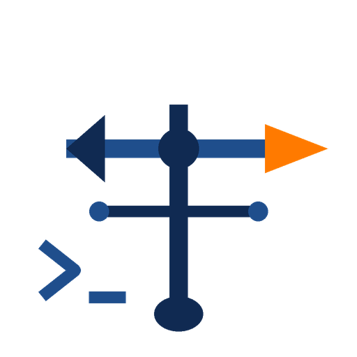

<p align="center">
  
</p>

<h1 align="center">clivane</h1>

<p align="center">
  <strong>Make ANY software agent-native — deterministically.</strong><br>
  Today's software serves humans. The next users are agents.<br>
  clivane gets your software ready for them — <em>without an expensive agent in the loop</em>.
</p>

<p align="center">
  
  
  
  
  
  
</p>

---

## What is clivane?

clivane is a single-file, pure-stdlib Python tool that converts software
into **agent-native CLIs** — command-line interfaces that AI agents
(Claude Code, Codex, Cursor, Gemini CLI, OpenCode, Copilot, …) can
discover via `--help`, drive with structured `--json` output, and trust
because every generated package carries **replayable proof** of how it
behaves.

Other approaches hand a software package to a large coding agent and let
it improvise a CLI over many expensive phases. clivane takes three
**deterministic** paths instead — the same input always produces the
byte-identical package, in about a second, for free:

| Path | Input | What you get |
|---|---|---|
| **forge** | a Python module | a full CLI: one subcommand per public function |
| **mirror** | an existing CLI tool | a wrapper that adds a structured JSON envelope |
| **openapi** | an OpenAPI 3 JSON spec | one subcommand per `operationId` |

…and one proof system for all three: **Trace-Seal**, golden traces that
are recorded once and replayed to verify behaviour, feeding an explicit
**Bronze / Silver / Gold** quality registry.

## Quickstart

No installation, no dependencies — just Python 3.10+:

```bash
git clone https://github.com/jawaadalah/clivane
cd clivane
python3 clivane.py selftest        # 6/6 checks, runs in seconds
```

### Path 1 — forge a Python module

```bash
python3 clivane.py forge examples/sample_app.py --out examples/notebox-cli
cd examples/notebox-cli
python3 sample_app_cli.py create-note --title "Hello" --body "first" --json
python3 sample_app_cli.py list-notes --json
python3 sample_app_cli.py            # no args -> stateful REPL
```

### Path 2 — mirror an existing tool

```bash
python3 clivane.py mirror ls --out examples/mirror-ls
python3 examples/mirror-ls/mirror_ls.py --json /tmp
# -> {"tool": "ls", "argv": ["/tmp"], "exit_code": 0, "stdout": "...", "stderr": ""}
```

### Path 3 — generate from OpenAPI

```bash
python3 clivane.py openapi examples/todoline.openapi.json --out examples/todoline-cli
python3 examples/todoline-cli/todoline_cli.py --help
python3 examples/todoline-cli/todoline_cli.py list-todos --base-url http://localhost:8799 --json
```

### Prove it — Trace-Seal + registry

```bash
python3 clivane.py verify examples/notebox-cli   # first run: SEALED
python3 clivane.py verify examples/notebox-cli   # every later run: PASS / FAIL
python3 clivane.py registry --dir examples       # tiers for every package
```

## The three paths in detail

### forge — static analysis, not vibes

`forge` parses your module with Python's `ast` module. Public functions
become subcommands; type annotations become coercion rules (`int`,
`float`, `bool`, `str`, and JSON-parsed `list`/`dict`); literal defaults
become optional flags; docstrings become help text. The generated CLI
ships with:

- one subcommand per public function, kebab-cased,
- `--json` on **every** command: `{"command": ..., "result": ...}`,
- a **stateful REPL** when run with no arguments — module state persists
  across commands inside the session,
- the target module copied alongside, so the package is self-contained,
- a generated `SKILL.md` (command map for agents), a smoke test, and a
  `manifest.json`.

### mirror — zero-code adoption for existing CLIs

Most software worth automating already has a CLI; it just speaks
human. `mirror` probes `<tool> --help`, extracts the subcommand map into
a `SKILL.md`, and generates a thin wrapper: arguments forward untouched
to the real tool, the exit code is preserved, and a `--json` flag
(intercepted, never forwarded) switches the output to a structured
envelope — `{"tool", "argv", "exit_code", "stdout", "stderr"}` — that
any agent can consume reliably.

### openapi — every operation, one command

`openapi` reads a local OpenAPI 3 JSON document and emits one
subcommand per `operationId`. Path parameters are substituted and
URL-quoted, query parameters become flags, POST/PUT/PATCH accept
`--body '<json>'`, and requests run on `urllib` — still zero
dependencies. `--json` wraps responses as `{"status", "body"}`.

## Trace-Seal & quality tiers

Generated code is easy; *trusted* generated code is the hard part.
Trace-Seal records a **golden trace**: the probe set (`--help`, every
command's `--help`, plus the package's `demo_calls.json`) executed in a
fresh copy of the package, with output normalised and stored in
`traces.json`. `verify` replays the same set and compares exactly —
drift in behaviour, or a hand-edited trace, fails loudly and names the
differing calls.

The registry turns that evidence into an explicit quality tier:

| Tier | Requirement |
|---|---|
| **Bronze** | package generated, manifest present |
| **Silver** | Bronze + all probe calls exit 0 (smoke level) |
| **Gold** | Silver + a Trace-Seal on file that replays **PASS** |

Tiers are **recomputed live** by `clivane registry` — the tier string in
a manifest is never trusted. See `examples/INDEX.md` for a live table:
all three bundled examples are Gold.

## Included examples

| Package | Path | Source | Commands | Tier |
|---|---|---|---|---|
| `sample-app-cli` | forge | `examples/sample_app.py` ("notebox") | create-note, list-notes, search-notes, count-notes, delete-note | Gold |
| `mirror-ls` | mirror | the system `ls` tool | (single-command tool) | Gold |
| `todoline-cli` | openapi | `examples/todoline.openapi.json` | list-todos, create-todo, get-todo, delete-todo | Gold |

`notebox` keeps its state in a JSON file and is deliberately
timestamp-free, which is what makes its golden trace stable — a good
pattern to copy for your own forge targets.

## How clivane compares

An honest comparison with the agent-harness approach (a coding agent
builds your CLI phase by phase, e.g. the 7-phase methodology popularised
by CLI-Anything):

| | clivane | agent-harness approach |
|---|---|---|
| Cost per CLI | **0** (local, deterministic) | many LLM/agent calls |
| Time per CLI | **~1 second** | minutes to hours |
| Needs an API key / agent | **no** | yes |
| Reproducibility | **byte-identical output** | varies per run |
| Backend required | only what the target itself needs | the real app must be installed |
| GUI desktop apps | via mirror (if they ship any CLI) or forge (Python cores) | **strongest case — deep GUI mapping** |
| Proof of behaviour | **Trace-Seal golden traces + tiers** | test suites written per project |
| Package size | 1 generated file + SKILL.md | full package tree per app |

Use the harness approach when a GUI application needs deep, semantic
mapping of its internals. Use clivane when you want agent access to
Python modules, existing CLIs, and HTTP APIs **today**, with proof.

## Repository layout

```
clivane/
├── clivane.py          # the whole tool (stdlib only)
├── selftest.py         # 6-check self-test suite
├── SOP.md              # the methodology — source of truth
├── examples/
│   ├── sample_app.py           # "notebox", the forge demo target
│   ├── notebox-cli/            # forged package (Gold, traces committed)
│   ├── todoline.openapi.json   # the openapi demo spec
│   ├── todoline-cli/           # generated package (Gold)
│   ├── mirror-ls/              # mirrored package (Gold)
│   ├── registry.json           # machine-readable registry
│   └── INDEX.md                # human-readable tier table
└── assets/logo.png
```

## Commands

```
clivane forge   <module.py> --out <dir>    # AST -> agent CLI
clivane mirror  <tool>      --out <dir>    # existing CLI -> JSON wrapper
clivane openapi <spec.json> --out <dir>    # OpenAPI -> per-operation CLI
clivane verify  <dir> [--record]           # Trace-Seal record / replay
clivane registry --dir <parent>            # tiers -> registry.json + INDEX.md
clivane list    <dir>                      # inspect one package
clivane selftest                           # run the self-test suite
```

## Methodology

Everything above follows one written standard: **[SOP.md](SOP.md)** —
the three paths, the Trace-Seal protocol, and the tier rules. If the
code and the SOP ever disagree, the SOP wins.

## Bahasa Indonesia (singkat)

clivane mengubah software apa pun menjadi CLI yang siap dipakai AI
agent, **tanpa LLM dan tanpa API key**. Tiga jalur deterministik:
**forge** (modul Python dianalisis statis via AST menjadi CLI lengkap),
**mirror** (CLI yang sudah ada dibungkus envelope JSON terstruktur), dan
**openapi** (spesifikasi OpenAPI 3 menjadi CLI per operasi). Setiap
paket hasil dibuktikan dengan **Trace-Seal** — rekaman golden trace yang
diputar ulang untuk verifikasi — dan diberi tier kualitas
Bronze/Silver/Gold di registry. Satu file Python, nol dependensi.

## License

Apache-2.0 — see [LICENSE](LICENSE).
